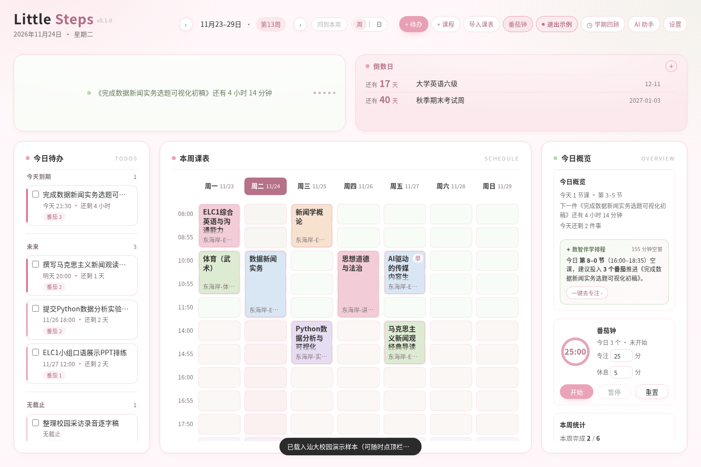
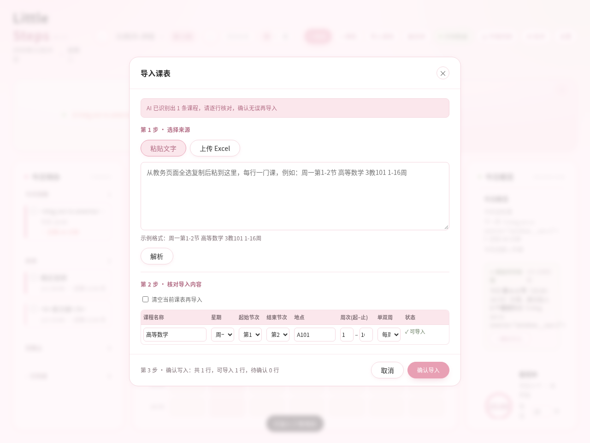
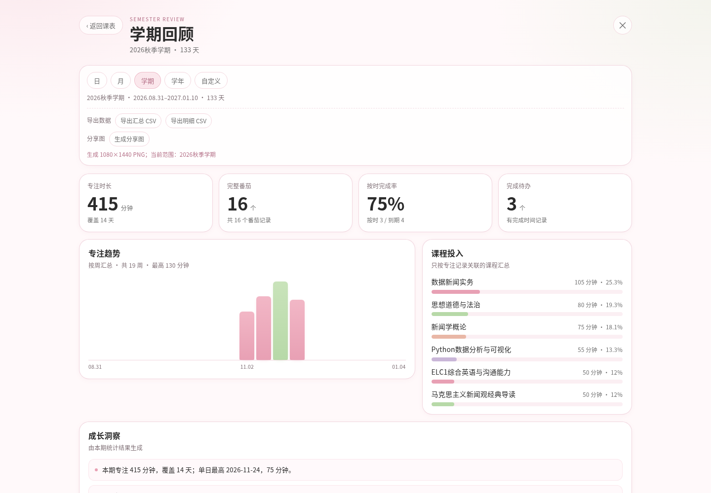

# Little Steps · 大学生数智学习日程助手（v5.1.0）

**在线体验**：https://lwxfly.github.io/little-steps/ （手机、电脑都能直接打开，不用下载，也不用注册）

Little Steps 帮大学生把课表、作业、专注时间和学期复盘放在一个网页里管理，让学生从“记住要做什么”进一步学会“安排好时间，回头看自己做得怎么样”。这是 2026 年广东省“数智新技艺”作品遴选「自主研发应用」类的参赛作品。



## 评审 3 分钟体验路径

1. 打开在线链接，点顶栏 **示例数据**，载入一份完整的校园示例（课表、待办、跨周专注记录）。个人数据不受影响，点 **退出示例** 就恢复。
2. 看右侧 **今日概览 → 数智伴学排程**：系统找出今天课表里的空档，推荐在哪一段做哪件事，点一下即可开始番茄钟。
3. 点 **+ 待办**，输入一句话，比如 `周五18:00交新闻学概论读书笔记 紧急 2番茄`，截止时间、优先级和番茄数会自动填好。
4. 点 **学期回顾**：查看专注趋势、按时完成率、各门课的时间投入，还可以生成分享图。
5. （可选）点 **AI 助手 → AI 设置**，填入 DeepSeek 或通义千问的 Key 后，可以试用任务拆解、课表识别和成长复盘。

## 作品亮点

### 1. 育人价值：培养自我管理能力，服务学风建设

- **从提醒到规划**：大多数待办工具只负责提醒。Little Steps 把课表空档、截止时间和优先级放在一起，建议学生“这段空课先做哪件事”，帮助学生养成提前规划的习惯。
- **把大任务拆小**：论文、实验报告、备考这类大任务往往拖到最后。AI 任务拆解会把它们拆成 1–4 个番茄钟就能完成的小步骤，学生勾选后直接加入待办。
- **定期复盘**：学期回顾用学生自己的数据（专注时长、按时完成率、课程投入）回答“时间花在哪了”。成长复盘先请学生写下自己的反思，AI 再给出下周的小目标，复盘记录会保存下来，形成个人成长档案。
- **引导正确使用 AI**：AI 在这里帮学生做规划、做复盘，不替学生写作业；识别出的课表也必须由学生逐行核对后才能导入。

### 2. 数智创新：规则算法与大模型结合

| 能力 | 实现方式 | 是否联网 |
| --- | --- | --- |
| 数智伴学排程 | 扫描当天 13 节课表的空档，按待办的截止紧迫度和优先级排序推荐 | 不联网，本地计算 |
| 一句话速建待办 | 本地解析中文自然语言里的日期、时间、优先级、提醒和番茄数 | 不联网，本地计算 |
| AI 任务拆解 | 大模型结合截止时间和本周上课时段，返回结构化步骤，本地校验后展示 | 用户启用后才联网 |
| AI 课表识别 | 识别粘贴的教务课表文字或截图，结果进入导入核对表 | 用户启用后才联网 |
| AI 成长复盘 | 以统计数字和学生自己写的反思为输入，生成下周目标 | 用户启用后才联网 |

常用功能都在本地完成，不依赖网络和 AI。AI 是可选的增强功能，兼容 OpenAI 协议，可以选 DeepSeek、通义千问、OpenAI，也可以接入自定义的兼容接口。



### 3. 隐私与安全：数据留在学生自己手里

- 没有账号，也没有作品自己的服务器。课表、待办、专注和复盘记录只保存在本机浏览器里，可以导出 JSON 备份，换手机时再导入。
- 未启用 AI 时，页面加载后不再发出任何外部网络请求。启用 AI 后，只有在点击 AI 按钮时才直接连接用户自己选择的服务商，而且只发送这次操作需要的内容。例如任务拆解只发送任务描述、截止时间和上课时段，不发送课程名和其他待办。
- API Key 只保存在本机，不会写进备份文件；AI 返回的内容一律按纯文本显示，防止脚本注入。
- 学期回顾分享图会自动隐藏具体课程名。
- v5.1.0 修复了一处概览区 XSS 漏洞，把 Excel 解析库 SheetJS 升级到修复了已知漏洞的 0.20.3，并增加了“保存失败”提示。

### 4. 技术特点：轻量、离线可用、可验证

- **单文件、零依赖**：整个应用就是一个 `index.html`（HTML5 + CSS + 原生 JavaScript），不需要框架和构建步骤，放在任何静态网站上都能运行。
- **PWA 离线**：通过 Web App Manifest 和 Service Worker 实现，可以“添加到主屏幕”，断网后也能打开。
- **本地解析教务课表**：支持 `.xlsx / .xls / .csv`（自动识别 UTF-8 / GBK 编码）和文字粘贴，导入前有三步可编辑的核对表，能自动合并单双周、去除重复。
- **与手机日历打通**：可以导出符合 RFC 5545 标准的 `.ics` 文件，把待办、课表和倒数日导入手机系统日历。
- **自动化测试**：`tests/e2e.js` 用 Playwright 在真实浏览器里跑 13 项端到端检查，覆盖 XSS 防护、AI 三个流程（接口为模拟）、Key 不进入备份、保存失败提示、离线缓存、手机端布局、示例模式和一句话速建。



## 按评审要求说明

| 项目 | 内容 |
| --- | --- |
| 研发及上线时间 | 2026 年自主研发；2026-11 上线 v4.7.0，2026-11-25 发布 v5.0.0 和 v5.1.0，以 GitHub 提交记录为准 |
| 应用功能 | 13 节周/日课表与教务导入、待办与一句话速建、数智伴学排程、番茄专注、倒数日、学期回顾与分享图、AI 学习助手、数据备份 |
| 编程语言与工具 | HTML5 / CSS3 / JavaScript；SheetJS 0.20.3；Service Worker；OpenAI 兼容接口；Playwright；Git + GitHub Pages |
| 运行环境 | 电脑端 Chrome / Edge / Firefox / Safari；手机端 iOS Safari、安卓 Chrome、微信内置浏览器 |
| 使用说明 | 打开链接 → 导入课表 → 添加待办 → 番茄专注 → 每周查看学期回顾；详见上方“评审 3 分钟体验路径” |
| 运营模式 | 托管在 GitHub Pages，没有服务器费用；AI 由用户自带 Key 按量付费，学校也可以统一申请额度；MIT 开源，其他学校可以直接部署或修改 |
| 实际效果 | 校内试用数据正在收集中，以参赛 PPT 为准 |

## 本地运行与测试

直接双击 `index.html` 就能使用（这种方式下离线缓存不生效）。运行测试：

```sh
npm i && npx playwright install chromium && npm test
```

测试使用模拟的 AI 返回，不需要真实的 API Key。

## 版本记录

| 版本 | 时间 | 更新内容 |
| --- | --- | --- |
| 5.1.0 | 2026-11-25 | AI 学习助手（任务拆解、课表识别、成长复盘）、PWA 离线、修复概览区 XSS、SheetJS 0.20.3、保存失败提示、端到端测试 |
| 5.0.0 | 2026-11-25 | 数智伴学排程、一句话速建待办、示例体验模式、布局优化 |
| 4.7.0 | 2026-11 | 首次上线：课表、待办、番茄钟、倒数日、Excel 导入、`.ics` 导出、学期回顾 |

## 开源许可

MIT License · Copyright (c) 2026 Feng Leyan (Shantou University)

内置的 SheetJS Community Edition 0.20.3 采用 Apache-2.0 许可。
